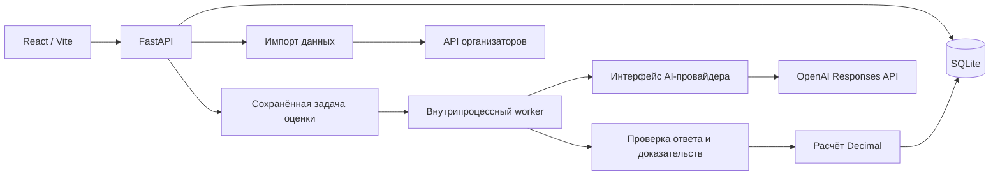

# Архитектура CQA

Версия: 0.1, 2026-11-07. Документ описывает целевую реализацию. Состояние реализации отмечается только в [роадмапе](ROADMAP.md).

## 1. Требуемое поведение

Пользователь получает новые диалоги, выбирает сохранённую версию чек-листа, запускает анализ и видит оценки с проверяемыми доказательствами. Затем он может оспорить конкретный критерий; проверяющий подтверждает или меняет решение с сохранением истории.

Обязательные возможности:

- Русский, казахский и английский; оценка только реплик оператора с учётом контекста других ролей.
- Получение DEV/контрольного набора по `group_id` и загрузка транскриптов в формате организаторов.
- Добавление/изменение критериев, инструкций, весов, шкал и доступности N/A через интерфейс.
- Объяснение и переход к сообщению для каждого критерия, включая N/A и пропущенное действие.
- Правильное применение весов, перераспределение при N/A, отдельный флаг грубых ошибок.
- Доступ к транскрипту звонка и переход к аудиоплееру по выданной ссылке.
- Сохранение исходного результата, апелляции, решения и финального итога.
- Настоящий анализ новых данных; после изменения чек-листа применяется новая версия правил.

Регистрация, распознавание речи и готовая интеграция с Dynamics 365 в MVP не входят. Структура клиента должна позволять дальнейшую адаптацию под HTML-компонент Dynamics.

## 2. Компоненты



Ключи AI и подписанная ссылка организаторов доступны только серверу. Браузер обращается к нашему API. Автоматическая загрузка произвольного URL, введённого в браузере, не предусмотрена.

## 3. Стек и структура проекта

Целевая структура. В A-01 уже созданы `backend/pyproject.toml`, lock, `app/main.py`, `app/config.py`, стартовые тесты и инфраструктура; остальные модули добавляются владельцами C/N/R:

```text
backend/
  pyproject.toml
  app/
    main.py                    # сборка приложения и lifespan worker
    config.py                  # настройки сервера
    api/routes/                # HTTP-обработчики
    schemas/                   # контракты Pydantic
    db/                        # подключение, транзакции
    models/                    # SQLAlchemy
    services/                  # импорт, чек-листы, запуск, апелляции
    evaluation/
      provider.py              # заменяемый интерфейс модели
      openai_provider.py       # облачная реализация
      pipeline.py              # критерии -> ответ -> проверка -> результат
      evidence.py              # проверка ссылок на сообщения
      scoring.py               # чистый расчёт без сетевых вызовов
      prompts/                 # инструкции с версией
  alembic/
  tests/
frontend/
  src/
    api/                       # типизированный клиент нашего API
    features/
      conversations/
      checklists/
      evaluations/
      appeals/
  tests/                       # Playwright
tools/
  evaluate_dev.py              # проверка точности на локальной разметке
data/
  fixtures/synthetic/          # собственные публичные примеры
  private/                    # игнорируется Git
docs/
compose.yaml
.env.example
```

Дополнительно созданы `contracts/` и `tools/export_contracts.py` для общих схем/экспортов, синтетические примеры в `data/fixtures/synthetic/`, `compose.api.yaml` для одного backend и `.github/workflows/ci.yml`. `compose.yaml` собирает клиент в Docker target `app` и запускает его вместе с API и внутрипроцессным worker; backend-only target `api` используется в `compose.api.yaml`. Границы подключения описаны в [INTEGRATION.md](INTEGRATION.md).

React/TypeScript/Vite планируется для интерфейса; FastAPI/Pydantic — для сервера и проверки данных; SQLAlchemy/Alembic — для хранения и миграций. Серверные зависимости зафиксированы в `backend/uv.lock`. `create_app(settings)` создаёт engine в lifespan и освобождает его после остановки; `app.state.settings`/`app.state.engine` предназначены для подключения C-модулей. Lifespan применяет Alembic-миграции на общем connection, создаёт идемпотентный seed, session factory и запускает worker; модули данных/оценки подключаются при сборке приложения (D-014). При остановке worker закрывается перед engine. Живые AI-вызовы отложены пользователем; интеграция без ключа возвращает явный отказ.

ASGI middleware охватывает весь HTTP-ответ, включая тело и фоновые задачи ответа (D-008). Ошибка до отправки заголовков возвращает безопасный JSON 500; после начала ответа сервер получает безопасное исключение без исходного контекста и завершает незаконченный поток. Порядок снаружи внутрь: журнал запросов → CORS → безопасная обработка исключений (D-009). Журнал `cqa.requests` содержит только статус, длительность и безопасный код ошибки; включает preflight, повышает уровень до WARNING для 4xx и ERROR для 5xx/позднего исключения. Код обработанной ошибки хранится в scope запроса через `error_response(..., request=request)`. Отдельный `app.diagnostics.log_internal_error` пишет в `cqa.errors` код и до 16 мест в коде репозитория без текста исключения, исходных строк или локальных переменных. Валидаторы URL проверяют порт/пробелы/управляющие символы, URL набора данных не допускает fragment; исходное значение не включается в сообщение ошибки, корректный подписанный URL сохраняется без нормализации.

## 4. Обработка данных

1. Сервер берёт подписанный URL из `CQA_DATASET_API_URL`. `group_id` заменяется через парсер query string; остальные параметры, включая подпись, сохраняются. Конкатенация нового параметра поверх существующего недопустима.
2. Импорт проверяет HTTP-статус, `isSuccess`, структуру `data.records`, роли, языки и сообщения. Пустой/повреждённый ответ не считается успешным импортом.
3. Идентичный повторный импорт определяется по источнику, `group_id`, `conversation_id` и хешу содержимого. Он не дублирует записи.
4. Изменение содержимого существующего диалога создаёт новую версию транскрипта. Старые оценки продолжают ссылаться на прежнюю версию.
5. Сообщения получают стабильные ID `m0001`, `m0002`, ... внутри версии транскрипта. Исходные порядок, роли и `timestamp` сохраняются без изменения.
6. Времена чатов MM:SS и звонков ISO 8601 не приводятся к одному формату с потерей исходного значения.

Для аудио показывается плеер или переход к записи. Перемотка к реплике реализуется только при известном соответствии времени реплики позиции записи. Нельзя считать первый timestamp началом записи без подтверждения.

## 5. Сценарий AI-оценки

1. `POST /api/v1/evaluations` фиксирует версии транскрипта и чек-листа и сохраняет запуск со статусом `queued`.
2. Worker переводит запуск в `running`, загружает зафиксированные данные и формирует инструкции из выбранного чек-листа.
3. Модель получает весь диалог с ID сообщений и ролями, определения критериев, шкалы и условия N/A. Содержимое переписки отделяется от инструкций анализатора.
4. Structured Outputs задаёт формат ответа. Модель возвращает каждый критерий ровно один раз: применимость, ответ, объяснение, ID доказательств и причины ручной проверки при необходимости.
5. Сервер проверяет типы, разрешённые ступени шкалы, условия структуры N/A, полноту критериев и существование сообщений/диапазонов. Текст цитаты берётся из исходного сообщения, а не из придуманной моделью строки.
6. Чистая функция расчёта применяет веса и N/A. Валидированный результат сохраняется атомарно, запуск получает `completed`.
7. При исчерпании ограниченных повторов или невалидном результате запуск получает `failed` с безопасным кодом ошибки. Система не записывает фиктивную оценку.

`queued → running → completed | failed`. Клиент опрашивает ресурс запуска примерно раз в 2 секунды и отображает реальное состояние.

Для MVP используется один API-процесс и ограниченная параллельность worker, первоначально 2. При перезапуске сохранённые `queued` снова ставятся в очередь, `running` отмечаются `failed/INTERRUPTED`: автоматический повтор такого запуска мог бы повторно потратить бюджет. Повторный запуск создаёт новый evaluation.

У сетевого клиента есть таймаут и ограниченный общий бюджет повторов. `CQA_LLM_MAX_RETRIES=2` означает максимум два дополнительных вызова сверх первого, включая исправление структуры. Прикладные и SDK-повторы не должны незаметно перемножаться. Для 429/временных 5xx учитывается backoff; ошибки ключа/доступа не повторяются бесконечно.

## 6. Граница AI-провайдера

Внутренний интерфейс, который фиксируется A-02 совместно с N-01:

```text
evaluate(transcript_snapshot, checklist_snapshot, prompt_version)
  -> ProviderResult(
       criterion_results,
       provider,
       model_requested,
       model_reported,
       usage,
       duration_ms,
       review_reasons
     )
```

Он не выполняет SQL-запросы, не меняет чек-лист и не рассчитывает итог. Сохранением и состоянием запуска управляет серверный сервис; валидацией доказательств и расчётом — модуль `evaluation`.

В результате сохраняются версия промпта, модель, длительность, фактическое usage всех попыток и, при известном тарифе, примерная стоимость. Детализацию токенов нельзя прибавлять повторно к уже включающему её общему usage. При неизвестной стоимости показывается «не рассчитана», а не ноль.

Обязательный baseline — один полный проход анализа. Второй проверочный проход, другая модель или локальный провайдер добавляются только после измерения пользы и включаются в стоимость одной оценки.

## 7. Хранение и неизменяемость

| Сущность | Основные данные и ограничения |
| --- | --- |
| `conversations` | UUID, источник, `group_id`, внешний `conversation_id`, язык, канал; уникальность по источнику/группе/внешнему ID |
| `transcript_versions` | UUID, conversation FK, content hash, исходные данные; unique(conversation, hash) |
| `messages` | FK версии, message ID, позиция, исходный timestamp, роль, текст; unique(version, message ID), unique(version, position) |
| `checklists` | UUID, название, указатель на последнюю сохранённую версию |
| `checklist_versions` | UUID, checklist FK, последовательный номер, JSON критериев; unique(checklist, version) |
| `evaluations` | UUID, две FK версий, статус, исходный итог, revision финального результата, модель/промпт/usage, ошибка |
| `criterion_results` | evaluation FK, criterion ID, исходная применимость/ответ/объяснение/доказательства; unique(evaluation, criterion ID) |
| `appeals` | UUID, evaluation/criterion, комментарий, статус, версия результата на момент обращения |
| `appeal_decisions` | appeal FK, действие, причина, новый ответ при override, время; одно финальное решение на обращение |

Индексы: источник/группа/внешний ID; conversation+created_at у версий и запусков; статус+created_at у запусков; evaluation+criterion у обращений; статус+created_at у обращений. Для SQLite включить foreign keys, WAL, busy timeout и короткие транзакции. Сетевой AI-вызов не выполняется внутри открытой транзакции БД.

Первичные результаты неизменяемы. Финальное представление строится из первичных ответов и последних подтверждённых решений по критериям. Пересчёт и увеличение `evaluation.revision` выполняются одной транзакцией. Все оценки ссылаются на собственные снимки, а не на текущий указатель чек-листа.

## 8. Апелляция

- Пользователь выбирает критерий завершённой оценки и пишет комментарий.
- Проверяющий видит исходный ответ, доказательства, текущий финальный ответ и комментарий.
- Решение `confirm` сохраняет текущий ответ; `override` задаёт новую применимость/оценку в пределах той же версии чек-листа. В обоих случаях причина обязательна.
- После решения пересчитывается финальный итог без вызова AI. Исходный итог и ответ остаются доступными.
- Одно открытое обращение на evaluation+criterion. Повторное решение по закрытому обращению и устаревший `expected_revision` возвращают 409.
- В демонстрации действия «подать» и «проверить» разделены интерфейсом. Регистрации нет, поэтому нельзя выдавать переключатель роли за проверенную личность или полноценную модель доступа.

## 9. Интерфейс

1. Список диалогов: импорт по группе/JSON, язык, канал, статус, последний результат.
2. Карточка: транскрипт, выбор версии чек-листа, запуск, состояние очереди, результат.
3. Оценка: исходный/финальный итог, критерии, N/A, грубые нарушения, объяснения и переходы к сообщениям.
4. Редактор: критерии, инструкции, шкалы, веса и N/A; сохранение новой версии.
5. Апелляции: форма, список и решение с причиной; сохранённая история.

Необходимы пустые состояния, ошибки импорта/модели, загрузка, повтор после ошибки и понятное обозначение mock-режима разработки. Рабочий сценарий не должен зависеть от заранее известных ID DEV-диалогов.

## 10. Точность и ограничения

Метрики и эталонная ручная разметка описаны в [плане проверки](TEST_PLAN.md). До получения разметки нельзя утверждать достигнутую точность.

Для проверки фактической правильности брокерской консультации может не хватать справочника тарифов и процедур. Модель не должна придумывать правила компании. Сомнения помечаются `review_required` с конкретной причиной; основой оценки остаётся доступный диалог и чек-лист. Возможное подключение подтверждённого справочника — отдельная задача после появления источника.

Контрольные 10 диалогов не используются для подгонки под заранее известные ответы. После стоп-кода можно импортировать данные и менять критерий через уже реализованный интерфейс.

## 11. Официальные технические источники

- [OpenAI: модели](https://developers.openai.com/api/docs/models) и [Structured Outputs](https://developers.openai.com/api/docs/guides/structured-outputs).
- [FastAPI: возможности и Pydantic](https://fastapi.tiangolo.com/features/).
- [Vite: клиентская сборка](https://vite.dev/guide/).
- [SQLite: подходящие сценарии использования](https://www.sqlite.org/whentouse.html).
- [Playwright](https://playwright.dev/docs/intro) и [pytest](https://docs.pytest.org/en/stable/).

Документация проверена при подготовке плана 2026-11-07. Перед реализацией проверить доступность выбранной модели для фактического аккаунта и актуальные параметры SDK.

## Пакеты оценки и сдача результатов (D-023/D-024)

Сохранённый пакет содержит фиксированный набор ссылок на evaluations. Каждый
запуск уже фиксирует transcript/checklist snapshots и обрабатывается тем же
внутрипроцессным worker; второго планировщика, Redis или дополнительного лимита
параллельности нет. Состояние пакета вычисляется по evaluations. Идемпотентный
request_id и один retry-child защищают от незаметной повторной оплаты. Retry-child
сохраняет весь состав и ссылки на успешные evaluations; новые задания создаются
только для failed. Экспорт полного набора после retry не требует ручного слияния файлов.

Отдельная read-only операция экспорта формирует официальный JSON1.0 из original
с совместимым исходным чек-листом. Она не вызывает модель и не публикует файл.
Отказы и review-required остаются error-строками с исходными ID. Подробный wire
контракт и ограничения — в API_CONTRACT.md; offline приёмка human labels —
в BENCHMARK.md. Работа с пакетами добавляется к существующему workspace без его
переписывания. Перед сдачей нужны независимое ревью, проверки сохранности истории
и безопасных логов, синтетический сквозной API/UI сценарий.
